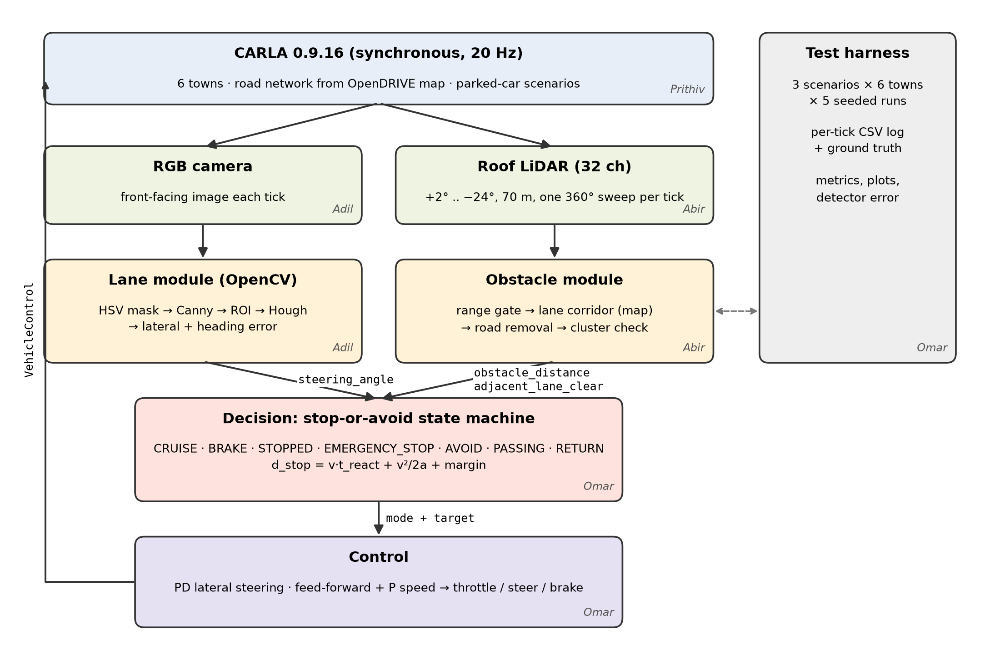

# Group 1 — Team plan (E6 · Team roles, plan & architecture)

Sprint 1: **10–24 Nov 2026** · Course: Engineering Teamwork, WS2026/27, SRH Berlin (A. Laboudi)

## 1. Roles

| Member | Role | Epics | Owns in the repo | Report section |
|---|---|---|---|---|
| Prithiv | Simulation & integration | E1, E5 (integration) | CARLA setup, repo conventions, integration loop | — (reviews all) |
| Adil | Lane detection & steering | E2 | camera lane module → `steering_angle` | II. Literature review |
| Abir | Obstacle detection (sensors) | E3 | `perception/` (LiDAR) → `obstacle_distance`, adjacent-lane check | III. Methodology |
| Omar | Collision avoidance, testing, docs | E4, E6 | `avoidance/`, `scenarios/`, `analysis/` | I, V, VI |
| Khalid | City navigation & innovation (joined after kick-off) | E5 (navigation) | junctions, turns, route following | IV. Innovation |

Everyone: rehearse the presentation; present their own module.

## 2. Meeting cadence and communication

*Proposal: confirm days and channel at the next meeting.*

| What | When | Where | Output |
|---|---|---|---|
| Stand-up (15 min) | Mon + Thu | Uni / Discord call | each person: done · next · blocked |
| Sprint review + planning (45 min) | last day of each sprint (24 Nov) | Uni | demo in CARLA, next sprint's cards |
| Async chat | any time | WhatsApp group | quick questions, links |
| Tasks | always | Trello board "Eng. Teamwrk" | card per task, moved to Done with evidence |
| Code | always | GitHub `carla-av-group1` (private) | one branch + pull request per card |

Rule of thumb: a blocker lasting more than one day is posted in the group chat, not saved for the next stand-up.

## 3. Sprint 1 goal and Definition of Done

**Goal:** the vehicle drives in CARLA and keeps its lane on the city map, with a working "obstacle ahead" signal.

A card is **Done** when:
1. It runs on the team's CARLA machine (CARLA 0.9.16, Python 3.11, `requirements.txt`).
2. The code is in the shared repo, merged via a pull request that one teammate reviewed.
3. `python -m pytest -q` passes (no CARLA needed).
4. It is shown working in CARLA (screen capture or a results CSV) and the evidence is attached to the card.
5. The README says how to run it.

**Sprint 1 status (as of 10 Nov):**
- E3 obstacle detection: done (LiDAR, 90/90 runs, 0 collisions).
- E4 collision avoidance: done ahead of plan.
- E2 lane detection: in progress (the evaluation currently uses a map-waypoint steering fallback).
- E1: repo + README done; installing on every machine is still open.

## 4. Architecture

Interfaces between modules (unchanged since kick-off):

| From | Value | Type |
|---|---|---|
| Lane module | `steering_angle` | float in [-1, 1] |
| Obstacle module | `obstacle_distance` | float metres to nearest obstacle in path, `None` if clear |
| Obstacle module | `adjacent_lane_clear` | bool, the lane we would swerve into is free |
| Decision | `ControlCommand(throttle, steer, brake, mode)` | applied to the CARLA vehicle every tick |

Plug-in point for new modules: `CarlaAvoidanceBridge(world, ego, cfg, lane_steer_fn=..., obstacle_distance_fn=..., adjacent_clear_fn=...)`.

## 5. Git conventions

- Branch per card: `e2-lane-detection`, `e5-junctions`, …
- Commit messages: `feat:`, `fix:`, `test:`, `docs:` + short description.
- Pull request into `main`, one reviewer, tests must pass. No direct pushes to `main` after Sprint 1.
- Large files (videos) go in GitHub Releases, not in git.

Regenerate the architecture figure: `cd carla_av && python -m analysis.architecture_diagram --owners --out ../report/figures/architecture_owners.png`.
